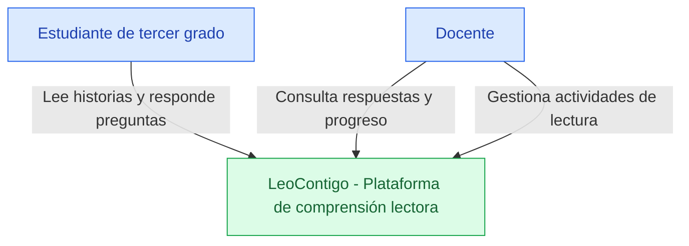
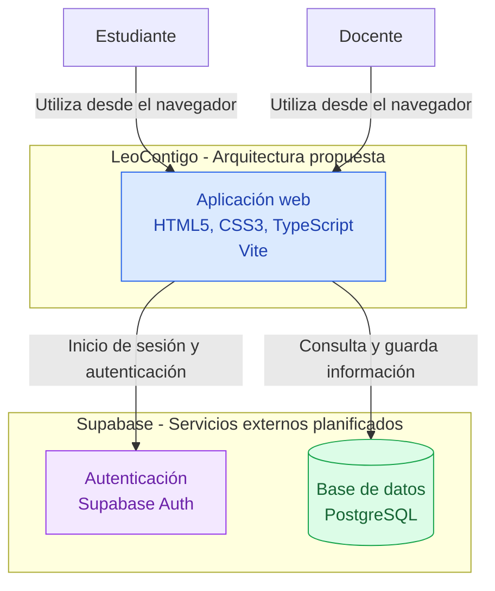

# Práctica 6 — Arquitectura C4 de LeoContigo

**Asignatura:** Ingeniería de Software II  
**Proyecto analizado:** LeoContigo  
**Objetivo:** Documentar la arquitectura del sistema mediante los niveles 1 y 2 del modelo C4.

## 1. Diagrama C4 — Nivel 1: Contexto del sistema

Este diagrama muestra cómo interactúan los usuarios con LeoContigo. El sistema se representa como una única unidad, sin detallar las tecnologías utilizadas internamente.

### Justificación de decisiones arquitectónicas

1. **Simplicidad:** Se propone una plataforma centralizada para que estudiantes y docentes accedan a las actividades sin utilizar aplicaciones diferentes.
2. **Mantenibilidad:** Diferenciar las funciones de estudiantes y docentes facilita organizar y modificar sus responsabilidades sin afectar innecesariamente otras funciones.
3. Esta separación prioriza la mantenibilidad frente a la simplicidad de tener una única interfaz idéntica para todos los usuarios.
4. **Usabilidad:** Las actividades de lectura se orientan a estudiantes de tercer grado, por lo que se prioriza una interacción sencilla y comprensible.
5. Se acepta invertir más esfuerzo en adaptar la experiencia a cada tipo de usuario para facilitar el uso de la plataforma.

## 2. Diagrama C4 — Nivel 2: Contenedores

Este diagrama muestra los principales contenedores y servicios de la arquitectura de LeoContigo, incluyendo las tecnologías seleccionadas para su desarrollo.

### Justificación de decisiones arquitectónicas

1. **Mantenibilidad:** Se seleccionaron TypeScript y Vite para facilitar el desarrollo y mantenimiento de la aplicación web mediante una estructura sencilla.
2. **Simplicidad:** Se prioriza una aplicación web sin un backend propio adicional, evitando incorporar componentes que todavía no son necesarios para el alcance del proyecto.
3. Esta decisión favorece la simplicidad y reduce el esfuerzo de mantenimiento, aunque limita la separación entre el cliente y el acceso a los servicios de datos.
4. **Seguridad:** Se propone utilizar Supabase Auth para centralizar la autenticación de estudiantes y docentes, en lugar de desarrollar un mecanismo propio de contraseñas.
5. Se acepta depender de un proveedor externo a cambio de reducir la complejidad de implementar autenticación, considerando necesario configurar políticas de acceso para proteger la información.

## 3. Correcciones realizadas al borrador generado con IA

Durante la elaboración de los diagramas se revisaron las tecnologías propuestas por la inteligencia artificial y se realizaron las siguientes correcciones:

- Se eliminaron Next.js y React porque no forman parte de las tecnologías seleccionadas para LeoContigo.
- Se eliminó NestJS porque no se ha definido un backend propio con ese framework.
- Se utilizaron HTML5, CSS3, TypeScript y Vite para representar la aplicación web.
- Se identificaron Supabase Auth y PostgreSQL como servicios planificados, sin presentarlos como funcionalidades ya implementadas.
- Se mantuvo el nivel 1 libre de tecnologías, respetando la separación entre contexto y contenedores del modelo C4.

Estas correcciones permitieron adaptar la documentación a las decisiones reales del proyecto y evitar componentes inventados por la IA.
